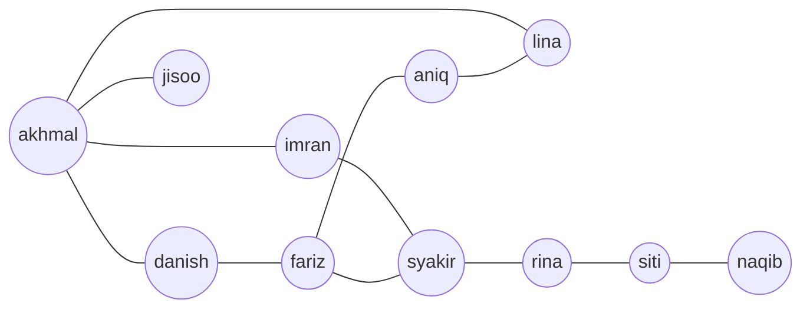

# 🌐 Social Network Analysis Knowledge Base — Declarative Logic Programming (Prolog)

[](https://www.swi-prolog.org/)
[]()
[-4CAF50?style=for-the-badge)]()
[]()
[](LICENSE)

> **Social Network Analysis in Prolog** is an Expert Knowledge Base and Declarative Inference Engine implemented in **SWI-Prolog**. It models symmetric friendship networks, common interest intersections, and complex social graph relations—such as mutual friendships, second-degree acquaintances, degree centrality (popularity), transitive reachability, and network influencer scores—using First-Order Horn Clauses and SLD Resolution.

---

## 📌 Theoretical Framework & Declarative Modeling

Unlike imperative programming, declarative logic programming specifies **what** relationships exist in terms of mathematical facts and inference rules, allowing the Prolog inference engine to answer complex graph-traversal queries via unification and backtracking.

### Core Capabilities:
* **Symmetric Adjacency Modeling:** Encodes bidirectional friendship relationships between network actors.
* **Transitive Closure Reachability:** Recursively evaluates whether a path exists between two arbitrary actors through arbitrary friend-of-friend intermediary hops (`connected/2`).
* **Centrality & Popularity Metrics:** Uses meta-predicates (`findall/3`, `length/2`) to compute actor degrees and identify highly connected individuals ($\ge 4$ connections).
* **Two-Hop Network Influence:** Identifies key social influencers based on the cardinality of their unique 2nd-degree friend network ($\ge 5$ friends-of-friends).
* **Closed-World Negation (`\+`):** Deduces negative knowledge, such as disconnected actors or below-average social connectivity.

---

## 🕸️ Network Graph Topology



---

## 📜 Predicate Reference & Logical Definitions

| Predicate | Arity | Formal Definition / Rule | Description |
|---|:---:|---|---|
| `friend/2` | 2 | `friend(X, Y).` | Symmetric base fact indicating direct friendship between $X$ and $Y$ |
| `mutual_friend/3` | 3 | `friend(X, M), friend(Y, M), X \= Y.` | Derives a shared friend $M$ bridging actors $X$ and $Y$ |
| `friend_of_friend/2` | 2 | `friend(X, Z), friend(Z, Y), X \= Y.` | Two-hop indirect acquaintance reachability |
| `popular/2` | 2 | `findall(Y, friend(X, Y), F), length(F, N), N >= 4.` | Evaluates degree centrality; succeeds if an actor has $\ge 4$ direct friends |
| `connected/2` | 2 | Transitive closure over `friend/2` | Recursive DFS graph reachability; succeeds if any valid path connects $X$ and $Y$ |
| `common_interests/3` | 3 | `interest(X, I), interest(Y, I), X \= Y, X @< Y.` | Identifies shared hobbies/interests between two individuals without duplicates |
| `influencer/2` | 2 | `findall(...) -> list_to_set -> Count >= 5.` | Classifies key influencers who bridge at least 5 unique second-degree connections |
| `not_popular/2` | 2 | `\+ popular(Person, Count).` | Closed-World negation identifying individuals with below-threshold connectivity |
| `not_connected_to/2` | 2 | `friend(X, Z), friend(Z, Y), \+ friend(X, Y).` | Identifies potential friendship recommendations (2-hop friends who are not yet directly connected) |

---

## 💻 Sample Prolog Queries & Expected Outputs

Launch the interactive SWI-Prolog interpreter and query the knowledge base:

### 1. Find Mutual Friends Between Akhmal and Fariz
```prolog
?- mutual_friend(akhmal, fariz, Mutual).
Mutual = danish ;
false.
```

### 2. Identify High-Degree Popular Individuals
```prolog
?- popular(Person, Count).
Person = akhmal, Count = 4 ;
false.
```

### 3. Find Shared Interests Between Different Individuals
```prolog
?- common_interests(akhmal, imran, Interest).
Interest = coding ;
false.
```

### 4. Query Influencers in the Network
```prolog
?- influencer(Actor, Count).
Actor = akhmal, Count = 5 ;
Actor = danish, Count = 6 ;
Actor = fariz, Count = 7 ;
...
```

---

## 📂 Project Directory Structure

```text
Social_Network_Prolog/
├── Social Network.pl  # Complete Prolog knowledge base (facts, inference rules, queries)
├── README.md          # Comprehensive declarative logic documentation
└── .gitignore         # Excludes editor backups and system artifacts
```

---

## 🛠️ Execution & Query Guide

### 1. Prerequisites
* Install **[SWI-Prolog](https://www.swi-prolog.org/Download.html)**:
  ```bash
  swipl --version
  ```

### 2. Clone the Repository
```bash
git clone https://github.com/akhmal02/Social_Network_Prolog.git
cd Social_Network_Prolog
```

### 3. Load the Knowledge Base into SWI-Prolog
```bash
swipl "Social Network.pl"
```

### 4. Run Queries Interactively
Once inside the Prolog prompt (`?-`), execute any of the sample queries documented above. Type `halt.` to exit.

---

## 👨‍💻 Author & Academic Attribution
* **Developer:** Muhammad Akhmal bin Mohamad Hussin ([@akhmal02](https://github.com/akhmal02))
* **Institution:** Universiti Teknologi MARA (UiTM)
* **Faculty:** College of Computing, Informatics and Mathematics
* **Course:** Logic Programming / Artificial Intelligence (CSC583 / CSC520)
